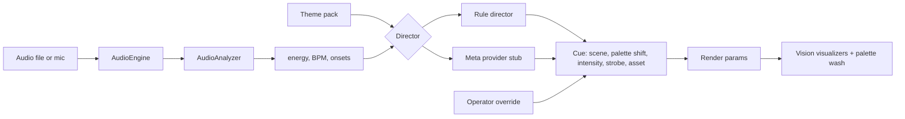

# AEI — Audio Experience Intelligence

AEI is the live director for immersive visuals at a music event. Before the
event it takes a theme pack (palette, motifs, mood, energy arc). During the
event it listens to the music and emits cues. `/aei` is that surface.

`/app` is PAPAGEDON Vision and is a separate route. AEI imports Vision's
visualizers and the existing audio analyzer. It does not modify them.

## Architecture



* **Theme pack** (`lib/aei/themes.ts`): palette, motifs, mood, and an energy arc
  from 0 to 1 across the event. Two packs are written by hand (`Afterglow Terrace`,
  `Harbor Glass`). Reading a flyer or a banner into a pack is later work.
* **Signals**: `AudioEngine` and `AudioAnalyzer` from `lib/papagedon/` (the same
  analysis Vision uses). Each frame exposes energy, bass / mid / treble, a BPM
  estimate, and an onset.
* **Cue** (`lib/aei/types.ts`): `scene`, `paletteShift`, `intensity`, `strobe`,
  `asset`, plus who decided it (`rules`, `meta`, or `operator`) and a short reason.
* **Rule director** (`lib/aei/director.ts`): works with no API key. Blended energy
  is `0.65 · live + 0.35 · theme arc`. Scene choice is smoothed and held (6 s)
  so the look does not flicker. Intensity and strobe follow the current frame.
  An onset strobes only when that blend is hot. `asset` is the theme motif for
  the current scene.
* **Operator**: the panel can lock scene, intensity, strobe, and palette shift.
  A lock is a cue with source `operator`.
* **Render params**: palette (three colours from the theme), intensity, scene id,
  strobe. Scene id selects a Vision visualizer — the original packs through
  `createNanoHexVisualizer`, the immersive scenes through `createImmersiveVisualizer`.
  Intensity scales the audio those visualizers already take. Strobe lengthens
  the beat pulse and paints a short flash. The palette is a wash over the
  imported materials; those materials stay owned by the Vision packs.
* **Meta provider** (`lib/aei/meta.ts`, called from `POST /api/aei/cue`): reads
  `MODEL_API_KEY` on the server. The key is not a `NEXT_PUBLIC_` variable and is
  not sent to the browser. `GET /api/aei/status` reports only whether the key is
  present. The request transport is unwired, so a key alone still returns
  "not wired" and the picture keeps using the rules. A Meta reply on `/aei` is
  written to the cue log; it does not replace the rule director.

## Run locally

```bash
npm install
npm run dev
```

Open http://localhost:3000/aei and choose **Play sample**. The sample is an
8.5 s, 120 BPM kick (`public/aei/sample-kick.wav`). **Load audio** takes a local
file. **Mic** listens to an input. The energy meter, BPM, onset dot, and cue
log should move with the music, and the picture should pulse on the kicks.

```bash
npm test
npm run build
```

## When the Meta key arrives

1. Set `MODEL_API_KEY` in the server environment (`.env.local` or the host).
   Do not prefix it with `NEXT_PUBLIC_`.
2. Replace `unwiredTransport` in `lib/aei/meta.ts` with one request that returns
   a `MetaCueDraft`: `scene`, `paletteShift`, `intensity`, `strobe`, optional
   `asset`, optional `reason`. `parseMetaCue` already rejects anything outside
   the scene pool or outside 0..1.
3. Muse Spark is the call for that structured cue. SAM 3.1 (segmentation) and
   Muse Image (motif textures stored against `asset`) belong behind the same
   provider, off the frame loop.
4. Point the stage at accepted Meta cues when you want them to drive the
   picture. Today they are log-only, so a bad draft cannot take the show.

Still open after that: turning a flyer or banner into a theme pack, and letting
one event's cues inform the next.
