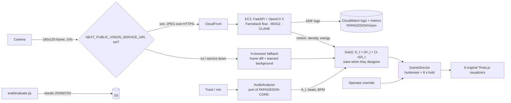

# PAPAGEDON Vision (OpenCV AI Competition 2026, powered by AWS)

PAPAGEDON Vision is an agent that **sees the crowd, hears the music, and directs
the visuals live** at `papagedon.com/app`.

## Architecture



* **Vision service** (`vision-service/`): OpenCV `5.0.0` (`opencv-python-headless==5.0.0.93`).
  Per session it keeps the previous frame and a MOG2 model:
  * motion: share of pixels with Farneback optical-flow magnitude > 0.8 px
  * density: share of foreground pixels from MOG2 (after a morphological open)
  * crowd energy: vertical "bounce" in the flow field + burstiness of motion over a 30-frame window
  * low light: CLAHE + Gaussian blur before flow; light cues/strobes (global brightness jump) are skipped
* **Fusion** (`lib/vision/fusion.ts`): `V_t = 0.45·motion + 0.25·density + 0.30·energy`,
  `E_t = αV_t + (1-α)A_t` (α default 0.4, slider in the UI). When `|V_t - A_t| > 0.35`
  the room energy is pulled toward the quieter signal, so loud music over a still crowd builds instead of peaking.
* **Director**: room energy picks one of the nine original visualizers, ordered calm→peak:
  Liquid Mirror, Wave Tunnel, Obsidian Bloom, Nano Hex Genesis, Armor Scales, Prism Shards,
  Circuit Matrix, Gilded Reactor, Electric Nexus. Hysteresis + an 8 s minimum hold stop flicker.
  Room energy also scales visual intensity (0.55× still room → 1.35× peak).
* **Fallbacks**: service unreachable 3× in a row → in-browser analysis. No camera / camera
  lost / no data for 1.5 s → audio-only. Operator can lock any scene (Manual or keys 1–9).

## Run locally

```bash
npm install && npm run dev                       # http://localhost:3000/app
cd vision-service && python -m venv .venv && . .venv/bin/activate
pip install -r requirements-dev.txt && pytest -q
uvicorn app.main:app --port 8080
# then NEXT_PUBLIC_VISION_SERVICE_URL=http://localhost:8080 npm run dev
# (for local use add ALLOWED_ORIGINS=http://localhost:3000 when starting uvicorn)
```

## Deploy to AWS (one command)

Needs AWS CLI v2 with credentials and Docker.

```bash
AWS_REGION=us-east-1 ./vision-service/deploy/deploy.sh
```

It builds and pushes the image to ECR, then deploys `deploy/template.yaml`
(CloudFormation): EC2 (t3.small, Amazon Linux 2023, Docker, IAM role with least
privilege), a CloudFront distribution for HTTPS (the EC2 port only accepts
CloudFront's origin-facing prefix list), CloudWatch log group `/papagedon/vision`
with Embedded Metric Format metrics (`AnalyzeLatencyMs`, `Motion`, `Density`,
`CrowdEnergy`) and a p95 latency alarm, and a private, encrypted S3 bucket for
evaluation results. It prints the URL to set as `NEXT_PUBLIC_VISION_SERVICE_URL`
on Vercel. Tear down with `aws cloudformation delete-stack --stack-name papagedon-vision`
(empty the S3 bucket first).

## Evaluation

```bash
cd vision-service
python eval/evaluate.py --synthetic                                  # no video needed
python eval/evaluate.py --video crowd.mp4                            # in-process OpenCV
python eval/evaluate.py --video crowd.mp4 --url https://<cloudfront> # end-to-end over the network
python eval/evaluate.py --video crowd.mp4 --s3 s3://<ResultsBucket>/eval
```

Writes `eval/results/<timestamp>.json` (throughput fps, latency mean/p50/p95/max,
metric means) and a per-frame CSV. Measured on the build box (not on AWS) with the
synthetic crowd, 320×240 JPEG frames, OpenCV 5.0.0:

| mode | frames | throughput | latency p50 | p95 |
|---|---|---|---|---|
| in-process | 300 | 182 fps | 5.1 ms | 5.7 ms |
| HTTP, localhost | 200 | 132 fps | 6.8 ms | 9.7 ms |

Re-run on EC2 and with real venue footage before quoting numbers.

## Limitations

* Crowd energy comes from optical-flow statistics, not a pose model. OpenCV 5's
  wheels no longer ship the HOG people detector, so there is no people count yet;
  a DNN pose/person model (`cv2.dnn`) is the next step.
* Signals are tuned by hand on synthetic and small samples, not a labelled venue dataset.
* One EC2 instance with in-memory sessions; it does not scale horizontally as-is,
  and the public DNS changes if the instance is replaced (redeploy updates CloudFront).
* The browser fallback is a simpler frame-difference stand-in, not OpenCV.

## Responsible use

* Crowd-level numbers only. No face detection, recognition, tracking of individuals,
  or identity of any kind. Frames are processed in memory and never stored; CloudWatch
  receives only the aggregate numbers and latency.
* The camera is off until the operator turns it on, and the browser asks permission.
* Venues should tell guests a camera is used for lighting/visuals.
* The operator can override the agent at any time; the show never goes dark if the camera or service fails.
